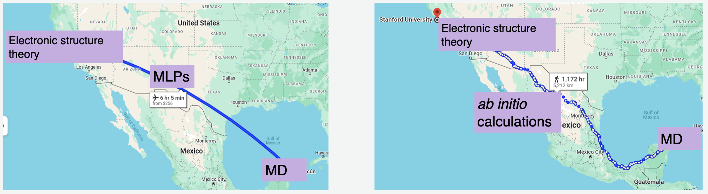

Here are the slides of my first rotation project at Stanford, in the Rotskoff group. I wrote my own implementation of SchNet ([Schütt et al., 2017](https://arxiv.org/abs/1706.08566)), a continuous-filter convolutional neural network for modeling interatomic interactions, in a way that made the most sense to me as an ML and PyTorch novice. I then ran some tests using a training dataset of DFT calculations on a simple system of 16 water molecules.

The coolest thing about this network is that the model is trained not only on the labels (in this case, the energies computed via DFT), but also on the energy gradients. In physics, the gradient of a system's energy with respect to atomic positions corresponds to the forces acting on the atoms. These learned forces can then be used to accelerate molecular dynamics (MD) simulations while approximating DFT-level (quantum mechanical) accuracy.

  

[📄 View PDF of PowerPoint Slides](/files/Schnet_Architecture.pdf)
