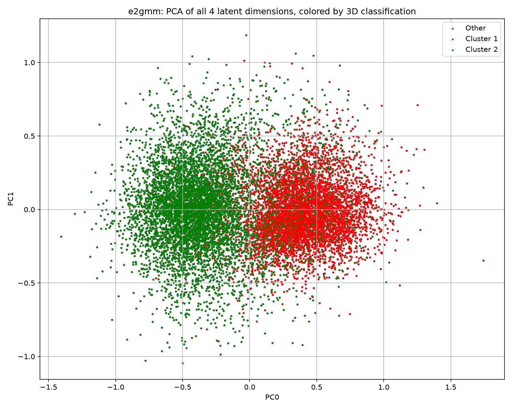
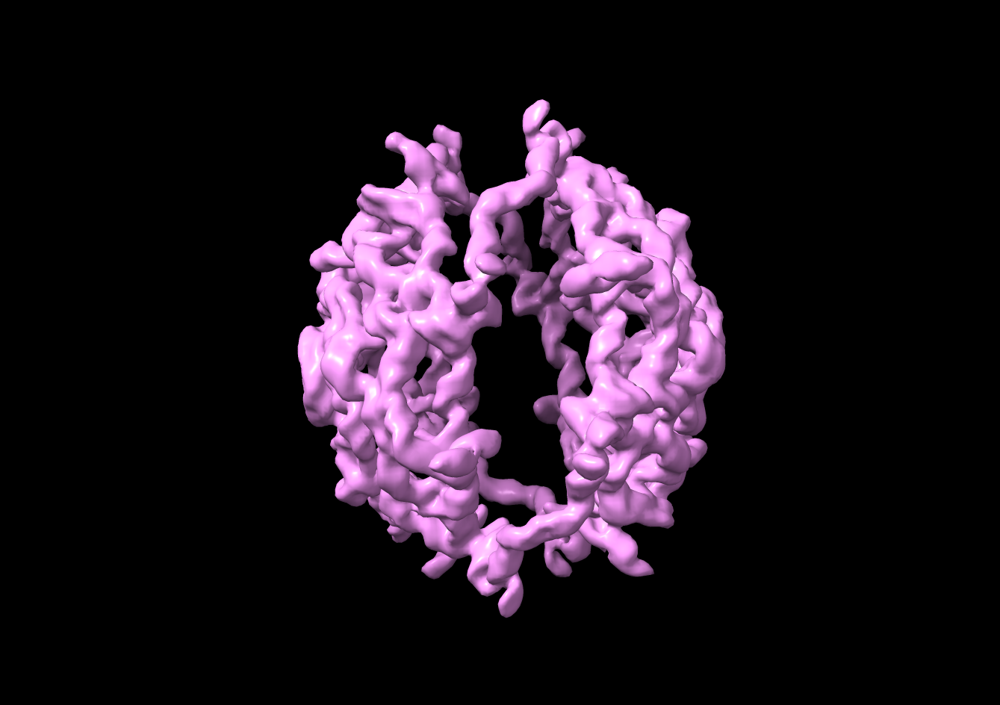
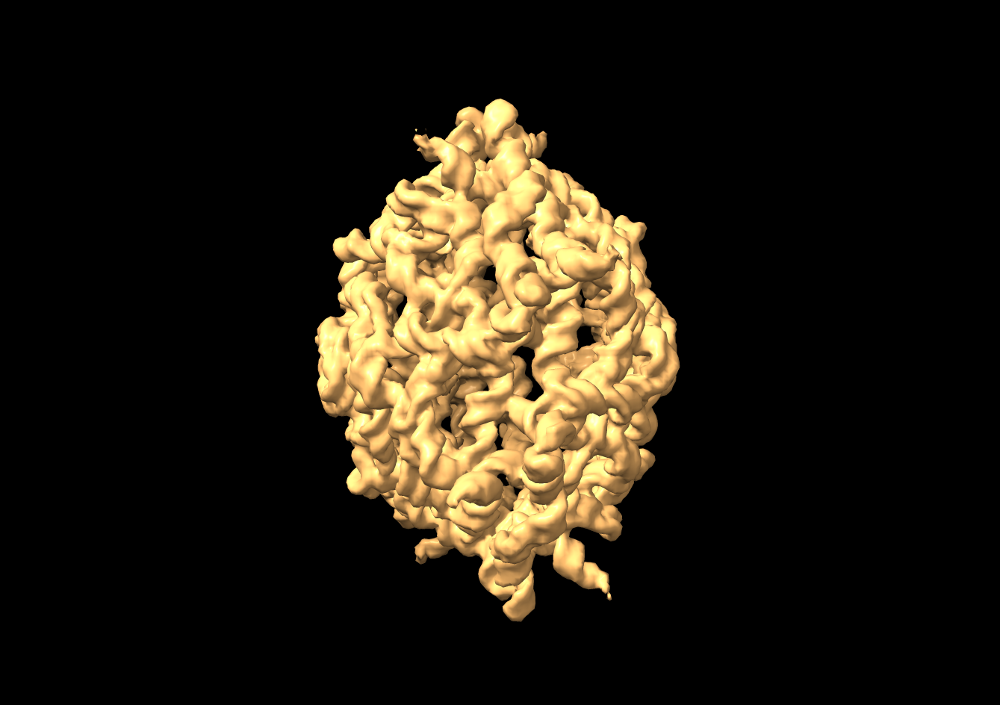
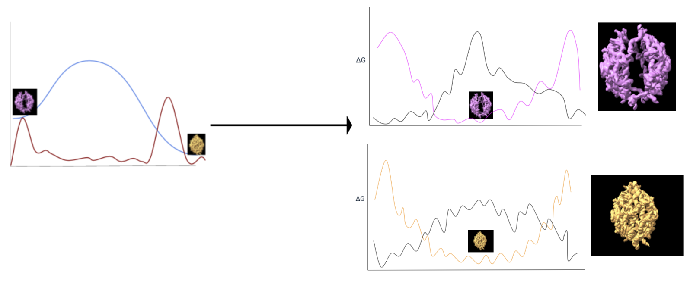

One of the most exciting structures solved by Rachael Kretsch using cryo-EM was the naturally ornate, RNA-only complex ROOL. Interestingly, this cage-like octamer appeared to be found in two dominant conformations, "open" and "closed", from simple 2D and 3D classification algorithms. However, it was unknown whether there might be a noticeable trajectory of intermediate states captured within the 2D micrographs. This summer I spent a few weeks using four cryo-EM heterogeneity algorithms: 3D Variability Analysis (cryoSPARC), 3DFlex (cryoSPARC), cryoDRGN, and e2gmm to evaluate 1) whether there could possibly be intermediate states present within the stack of particles and 2) whether each algorithm separated the particles into the same clusters. 

Based on cluster profiles from all algorithms, we concluded that only two dominant states were present in the particle stack. To see how each algorithm clustered particles (color labelled by the initial 3D classification job), you can copy the making_plots directory in the /notebooks folder, and then interactively play around with Making_plots.ipynb. 

[View Notebook](https://github.com/georgiagracetully/georgiagracetully.github.io/blob/master/notebooks/making_plots/Making_plots.ipynb)

Note: By just scanning the notebook you may think that particle ids are colored with corresponding clusters from each algorithm, but they are colored according to their separation into "open" and "closed" states by the simple 3D classification algorithm, which by eye corresponds with clusters from all four heterogeneity algorithms. In the e2gmm latent space (below: PCA of all 4 latent dimensions), the two classes separate along PC0 but overlap near the boundary, where about 9% of particles sit closer to the other class's centroid than to their own.

 

   
Pretty obvious from the images above which conformation is "open" or "closed". 

 
Probing the conformational landscapes of ROOL particles from open and closed classes separately with heterogeneity algorithms. Figure on the left represents a simplified energy landscape of ROOL (blue) superimposed with an estimated relative population of states (red) to illustrate the hypothesis that open and closed conformations represent favorable thermodynamic states separated by a kinetic barrier. Figures on the right represent individual simplified energetic landscapes of the open (top, pink) and closed (bottom, yellow) states with black lines representing an estimated relative population of particles in corresponding states. Our analysis changed from trying to recover states within the poorly populated red region between both open and closed states (left), to the rare populated peripheral regions of either primary structure (right).

Here is a write-up of selected results in a summary analysis. This work was performed in the Das Lab. 

[📄 View PDF ROOL heterogeneity project](/files/Tully_Summer_Project_summary.pdf)

Related paper from the Das Lab describing the ROOL structures: 
(1)	Kretsch, R. C.; Wu, Y.; Shabalina, S. A.; Lee, H.; Nye, G. P.; Koonin, E. V.; Gao, A.; Chiu, W.; Das, R. Naturally Ornate RNA-Only Complexes Revealed by Cryo-EM. Nature, 2025. https://doi.org/10.1038/s41586-025-09073-0 (preprint: https://doi.org/10.1101/2024.12.08.627333).
