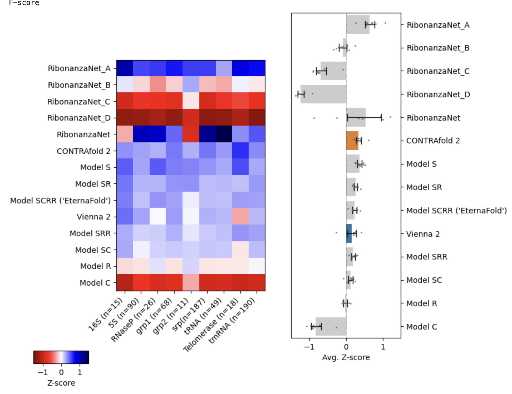
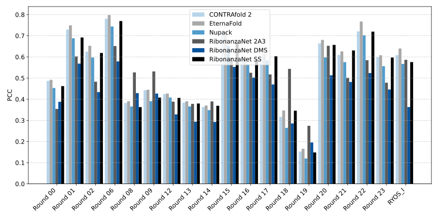
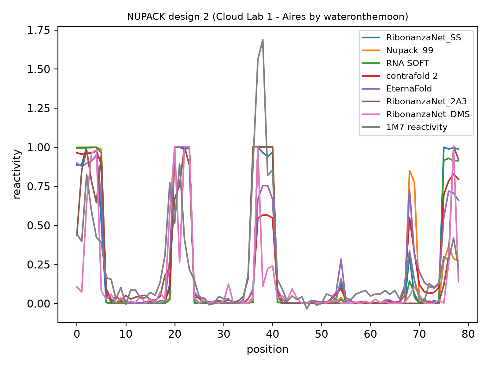
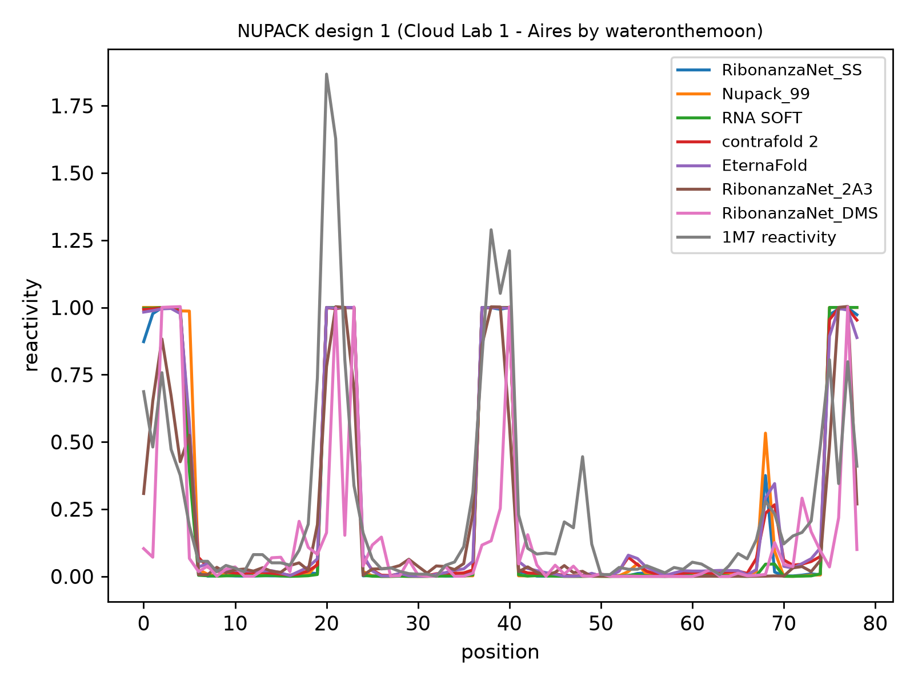
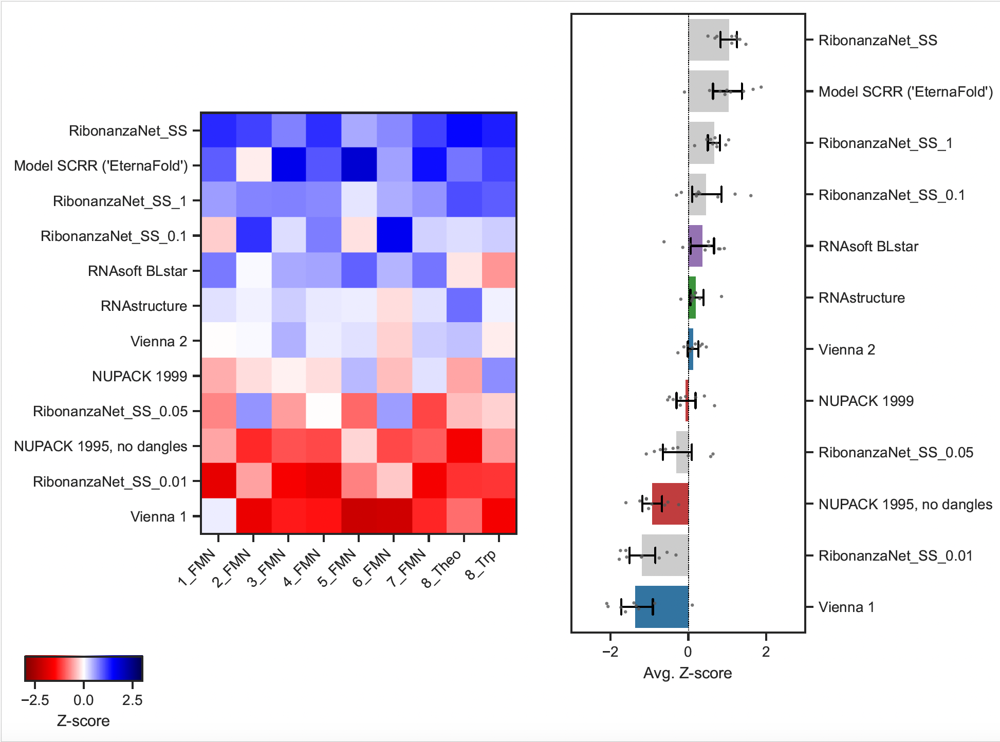

One of the most exciting breakthroughs in structural biology and machine learning was AlphaFold's performance at the CASP14 competition - demonstrating the power of deep neural network models in protein structure prediction. More recently, AlphaFold 3 has expanded to include the prediction of biomolecular interactions and nucleic acids. However, there remain noticeable limitations in predicting large, RNA-only complexes, as some AlphaFold 3 models contain severe steric clashes and breaks in the phosphodiester backbone (3). The poor performance of AF3 on RNA structure prediction is often attributed to the scarcity of RNA structural data in the PDB. As a result, many have suggested augmenting the sparse 3D RNA structural data with secondary structure chemical mapping data. The idea was to train a deep neural network to predict, given an RNA sequence, its corresponding chemical mapping reactivity profile. This model could then be fine-tuned on downstream tasks with smaller datasets - including tertiary structure prediction. The startup Atomic AI released a publication of its model ATOM-1 (not available to the public) demonstrating the feasibility of this idea. Similarly, the Das Lab released a publication describing the model RibonanzaNet, trained on chemical mapping data from millions of RNA sequences, that also performs well on downstream tasks. This model, designed by Shujun He with insight from various other Kaggle models, is free to use and available [here](https://github.com/Shujun-He/RibonanzaNet).

A few years ago, the Das Lab also released a [paper](https://pmc.ncbi.nlm.nih.gov/articles/PMC9839360/) with benchmark datasets of RNA secondary structure, chemical mapping profiles, and ligand binding equilibrium constants. Additionally, this paper released a statistical model, EternaFold, that used the baseline [CONTRAfold](https://doi.org/10.1093/bioinformatics/btl246) architecture but was trained on all three unique datasets. In that paper, EternaFold outperformed the other secondary structure packages tested across these benchmark tasks. 

Using the EternaBench datasets, I evaluated RibonanzaNet's performance on all tasks, regenerating figures in the EternaBench paper as well as creating my own based on raw data. 

# RibonanzaNet Secondary Structure Evaluation: 

Regenerated heatmap of Z-scores of F-scores from EternaBench paper on ArchiveII dataset of secondary structures: 

   

This is RibonanzaNet-SS trained with different checkpoints that vary by the amount of training data. RibonanzaNet_SS is the RibonanzaNet-SS model trained on all 2 million sequences in the Ribonanza dataset. RibonanzaNet_SS_1, _0.1, _0.05, and _0.01 are models trained on 140k, 14k, 7k, and 1.4k training examples, respectively. 

# RibonanzaNet Chemical Mapping Evaluation 

A dataset of chemical mapping profiles using the [SHAPE](https://pmc.ncbi.nlm.nih.gov/articles/PMC4259394/pdf/nihms606325.pdf) reagent 1M7 of natural and human-designed RNAs was compiled, and correlation coefficients were computed, with z-score heatmaps generated. 

Here is a bar chart comparing Pearson correlation coefficients with RibonanzaNet-SS, RibonanzaNet-2A3, and RibonanzaNet-DMS. 

 

Here are two example RNAs from the Round 1 data, each showing its own measured 1M7 reactivity alongside the packages' predicted reactivity profiles. On these two designs most packages track the measured profile reasonably well (Pearson r ≈ 0.6–0.8; RibonanzaNet-DMS ≈ 0.5), although the measured profiles are spikier than the predictions. Note, the simulated reactivity profile from secondary structure prediction models comes from converting base pairing matrices to probability unpaired vectors (punp vectors), which is outlined in the Das Lab [arnie](https://github.com/DasLab/arnie) wrapper. 

  
  

You can play around with reactivity profiles yourself by copying the folder in this repository /notebooks/eternabench_chemmapping_simulation (and all the contents within it) here: 

[View Notebook](https://github.com/georgiagracetully/georgiagracetully.github.io/blob/master/notebooks/eternabench_chemmapping_simulation/EB_Chemmapping_Profile_EVAL.ipynb)

# RibonanzaNet Riboswitch Ligand-Binding Prediction Evaluation 

The last metric evaluated was the predictive ability of each model to predict the ligand-binding affinity of riboswitches indirectly through the probability of the terminal base pair in the aptamer hairpin. Predicting binding affinity directly by fine-tuning RibonanzaNet on this data is covered in a [later project](/portfolio/project-6/). 

These riboswitches were designed so that upon binding one of the input ligands, flavin mononucleotide (FMN), theophylline (Theo), or tryptophan (Trp), the MS2 protein aptamer becomes more accessible, thereby increasing binding affinity of the fluorescent protein. Experimental measurements of MS2 protein binding affinities with and without ligand present (K+lig and K-lig) were performed on this diverse dataset.  

Because the MS2 aptamer is a hairpin, a zero-shot evaluation on riboswitch binding affinities without ligand bound (K-lig) was performed using RibonanzaNet-SS bpp matrices on the EternaBench holdout dataset. Evaluating checkpoints of RibonanzaNet-SS trained with different amounts of data showed how prediction accuracy depends on training data quantity (with the model architecture held fixed).  

   

Relevant Papers: 

(1)	He, S.; Huang, R.; Townley, J.; Kretsch, R. C.; Karagianes, T. G.; Cox, D. B. T.; Blair, H.; Penzar, D.; Vyaltsev, V.; Aristova, E.; Zinkevich, A.; Bakulin, A.; Sohn, H.; Krstevski, D.; Fukui, T.; Tatematsu, F.; Uchida, Y.; Jang, D.; Lee, J. S.; Shieh, R.; Ma, T.; Martynov, E.; Shugaev, M. V.; Bukhari, H. S. T.; Fujikawa, K.; Onodera, K.; Henkel, C.; Ron, S.; Romano, J.; Nicol, J. J.; Nye, G. P.; Wu, Y.; Choe, C.; Reade, W.; Eterna participants; Das, R. Ribonanza: Deep Learning of RNA Structure through Dual Crowdsourcing. bioRxivorg 2024. https://doi.org/10.1101/2024.02.24.581671.

(2)	Wayment-Steele, H. K.; Kladwang, W.; Strom, A. I.; Lee, J.; Treuille, A.; Becka, A.; Participants, E.; Das, R. RNA Secondary Structure Packages Evaluated and Improved by High-Throughput Experiments. Nat. Methods 2022, 19 (10), 1234–1242. https://doi.org/10.1038/s41592-022-01605-0.

(3)	McDonnell, R. T.; Henderson, A. N.; Elcock, A. H. Structure Prediction of Large RNAs with AlphaFold3 Highlights Its Capabilities and Limitations. J. Mol. Biol. 2024, 436 (22), 168816. https://doi.org/10.1016/j.jmb.2024.168816.
