Previously, it has been demonstrated that probing RNA with chemical modification reagents, also known as chemical mapping or chemical footprinting, can be used to identify ligand-binding regions on RNAs by comparing site-specific reactivity changes of nucleotides incubated with small molecules. [1,2] My plan was to apply this proof-of-concept result with the Das Lab's high-throughput chemical mapping protocol to generate a dataset of millions to billions of RNA-ligand interactions to develop a deep learning model that predicts sequence-specific binding of small molecules. 

Once a trained model could accurately predict both binding affinity and binding location from RNA and small molecule features, my initial goal was to fine-tune it to identify small molecule binders for pathogenic RNA targets—aiming to disrupt their structure and, consequently, their function. However, my interest gradually shifted toward designing RNA aptamers for diagnostic applications or for complex biological computation. My plan was then to expand the model by incorporating a reinforcement learning framework to generate designs for high-affinity aptamers for any given small molecule input.

While I unfortunately had to forfeit this project, I did get preliminary results suggesting that an RNA foundation model can be fine-tuned to predict small-molecule-induced changes in chemical reactivity, at least for molecules with strong effects (see the quantitative results below). 

A pilot experiment was performed in July 2024 using the SHAPE chemical mapping protocol on a library of 3000 RNAs designed to have pseudoknot motifs, incubated with small molecules known to bind RNA - Argininamide, Erythromycin, Kanamycin, Mitoxantrone, Paromomycin, Spectinomycin, and Tetracycline. 

I fine-tuned multiple models of RibonanzaNet, adjusting hyperparameters and model architecture. At first, I tried to fine-tune RibonanzaNet alongside an embedding generator block so that the model could generalize beyond the initial 7 small molecules in the training data. But the training time was taking too long (around 2 hours/epoch) for a pilot experiment with the primary goal being to test whether RibonanzaNet already contains the information necessary within RNA sequence and/or pairwise embeddings to predict interactions with small molecules (given just a small initial amount of data for training). 

The base RibonanzaNet model was trained on data from two separate chemical probing techniques: SHAPE (Selective 2'-Hydroxyl Acylation analyzed by Primer Extension) probing with the electrophilic reagent 2-aminopyridine-3-carboxylic acid imidazolide (2A3) [3] as well as DMS chemical footprinting [4]. My initial experiment was simple: adjust the final decoder layer of RibonanzaNet to instead predict 2-8 reactivity profiles, with each reactivity profile being a new small molecule condition. I would first assess model performance through quick visual checks on heat maps of experimental and predicted reactivity profiles under each condition. If the predictions looked promising, I would then generate a more robust quantitative analysis to benchmark model predictions. 

## The Experiment 

Experimental Null Hypothesis: RibonanzaNet cannot be fine-tuned on 1k new labeled examples of RNA/small-molecule chemical reactivity profiles to make accurate predictions on the test data. 

Possible explanations of Null Hypothesis: 

1) The experimental data itself is pure noise. There is no predictable pattern that even a large pretrained model can learn.   
2) The model needs more diverse training data to learn.   
3) The model needs more parameters or a more sophisticated architecture tailored to the new task in order to learn RNA-small molecule reactivity profiles.   

## Selected Results - Qualitative 

The best results qualitatively from this pilot experiment came from RibonanzaNet-SM 005. This model was trained with a final decoder layer of 8 reactivity profiles, the first seven being *reactivity differences* between the small molecule condition and a no small molecule baseline (I called this baseline "NoDr" for "No Drug", since all of these molecules are drugs). The last vector was the absolute reactivity profile without small molecule incubation. The idea is that since I used MSE or MCRMSE as the loss function during training, adding in the absolute reactivity vector would normalize the gradient so that the model would not overfit to the data with the largest magnitude of reactivity differences. However, as you will see with my quantitative results, this still became a problem, as there was a direct correlation between the magnitude of reactivity differences and the PCC of predictions under each drug condition. But again, this was just a preliminary experiment to evaluate whether RibonanzaNet contained information necessary within the pretrained model to make predictions under new conditions. Ideally, since this model is relatively lightweight and easy to fine-tune, it could be used by experimentalists with small datasets to predict RNA behavior under other conditions. Alternatively, we would collect enough new RNA reactivity profiles with different small molecules so that, combined with a pretrained molecular embedding model and a new model architecture tailored to that task, we could retrain a model from scratch. 

Here are some selected qualitative results; you can play around with generating heatmaps of all RNAs in the test dataset under each condition by copying this [repository](https://github.com/georgiagracetully/georgiagracetully.github.io/tree/master/notebooks/sm_data) and running cells in this [notebook](https://github.com/georgiagracetully/georgiagracetully.github.io/blob/master/notebooks/sm_data/Selected_RibonanzaNet_SM_Qualitative_Heat_Maps.ipynb).

An example of different experimental and predicted reactivity *differences* on a sequence from the test set from RibonanzaNet 005: 

### Sequence 13
 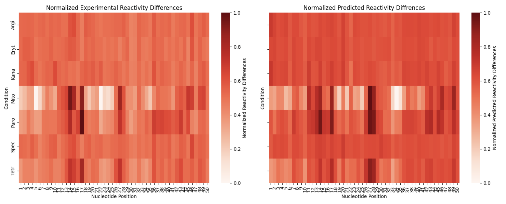

### Sequence 2 
 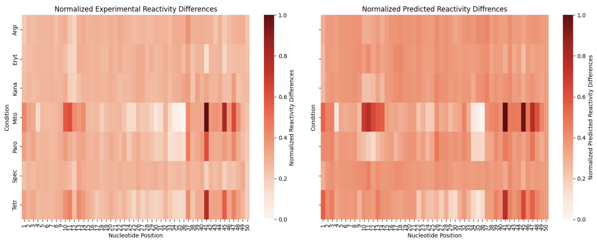

A look at individual reactivity profiles (not normalized) for each condition for sequence 2: 

  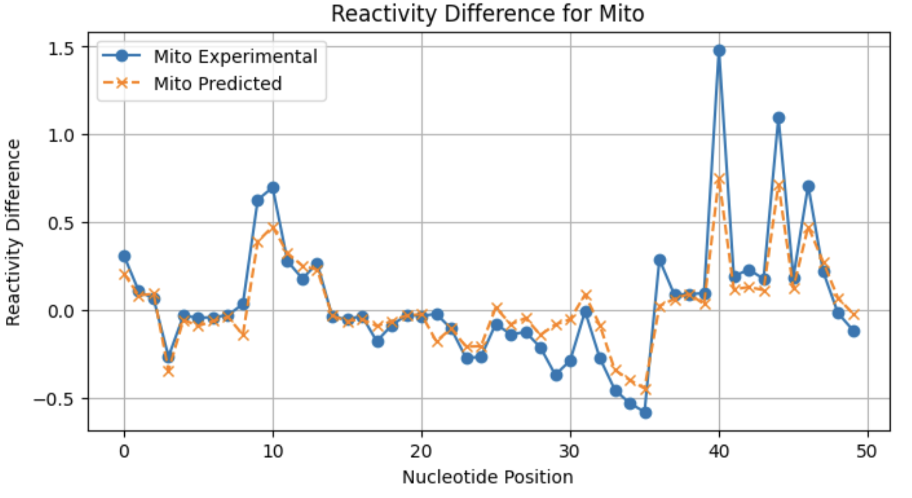
  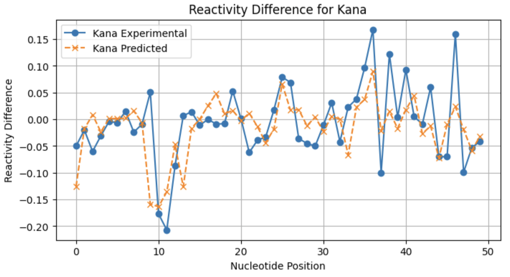
  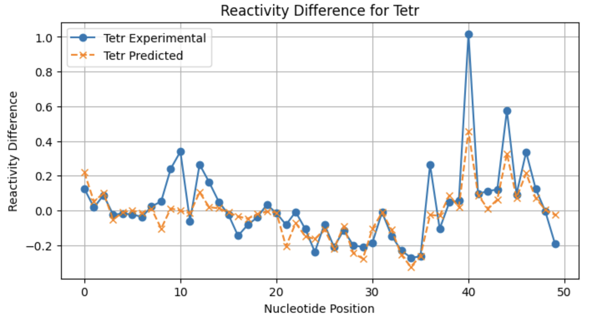

  
  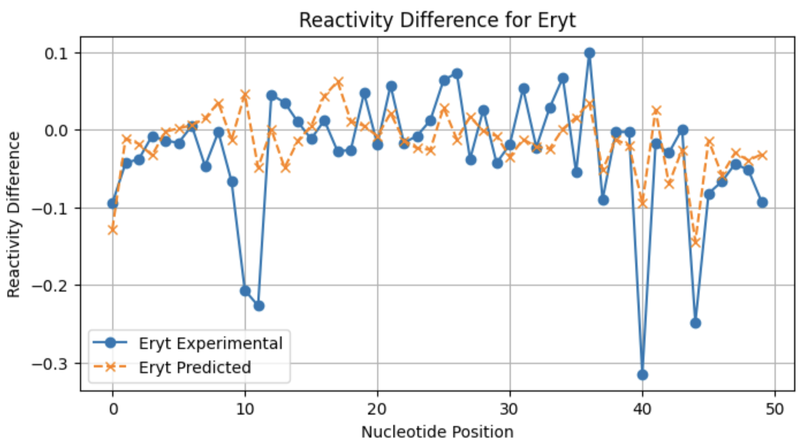
  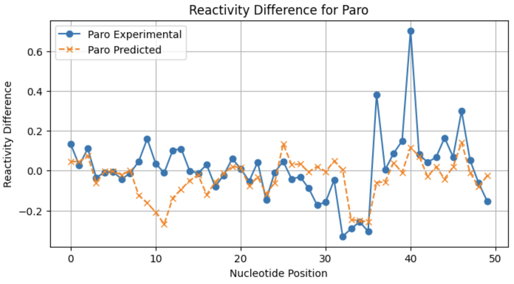

  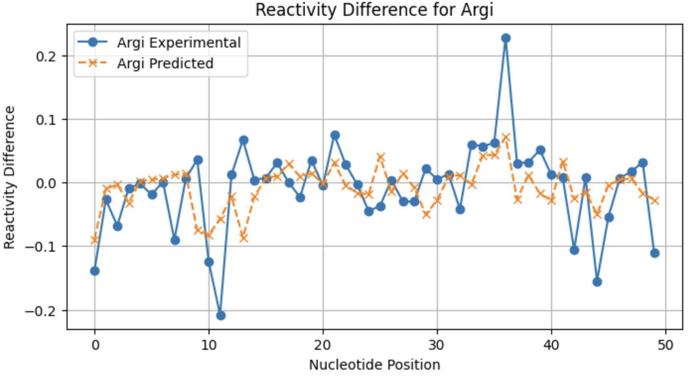

From these profiles, you can see that the model may not be as good at predicting large reactivity differences for conditions with a lower frequency of significant reactivity differences. 

Here I compare Erythromycin, a condition with few binding events, with and without the absolute reactivity vector in training. Each figure shows measured (left) and predicted (right) reactivity differences for test sequences 50-100, on the same color scale. 

Adding the absolute vector made the model predict somewhat larger changes (99th percentile of predicted |difference| 0.18 vs. 0.11), but both models still predict much smaller changes than were measured (0.72), and correlation with experiment did not improve (mean per-sequence r = 0.20 with vs. 0.23 without, across all 546 test sequences). 

### RibonanzaNet-004 No absolute reactivity vector included during training

  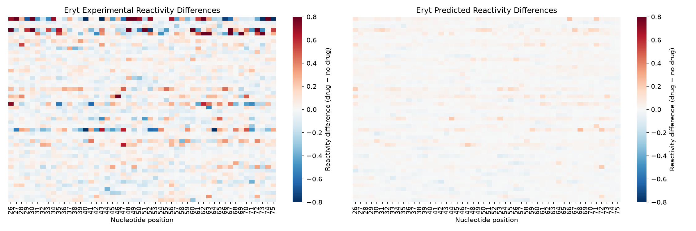

### RibonanzaNet-005 Includes all reactivity differences, and the absolute reactivity vector 

  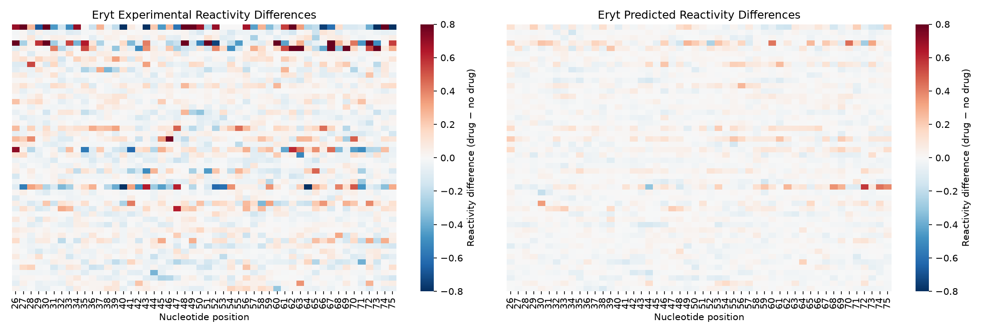

There is still much need for improvement in terms of accuracy; however, this is a good start for guiding future fine-tuning projects. 

## Selected Results - Quantitative 

The first quantitative metric, which was also used to evaluate improvement during training, is the Pearson correlation coefficient (PCC) between the experimental reactivity vectors and predictions. For RibonanzaNet-SM 005, here are the computed PCCs per condition: 

Average PCC per condition:

Argi    0.15  
Eryt    0.20  
Kana    0.28  
Mito    0.75  
Paro    0.56  
Spec    0.13  
Tetr    0.61  

Another quantitative metric I used was to flag nucleotides that are in the top 80% of reactivity difference, compute a sliding window sum of flagged nucleotides, and then compute a PCC of predictions with experimental flagged nucleotides. 

Average PCC per condition:

Argi    0.16  
Eryt    0.20  
Kana    0.22  
Mito    0.65  
Paro    0.44  
Spec    0.17  
Tetr    0.55  

These correlations have not yet been compared against a simple baseline (for example, predicting each condition's reactivity difference from the no-drug reactivity profile alone, or from RibonanzaNet without fine-tuning), so they show that the signal is partly learnable for some molecules but not yet how much the fine-tuning itself adds.

  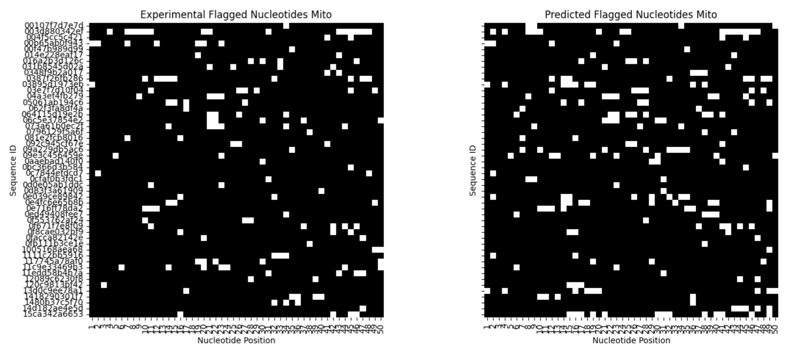

You can clone this [repo](https://github.com/georgiagracetully/georgiagracetully.github.io/tree/master/notebooks/sm_data) and then run the [Jupyter notebook](https://github.com/georgiagracetully/georgiagracetully.github.io/blob/master/notebooks/sm_data/Selected_Plots_RibonanzaNet_SM_Quantitative_Data_Analysis.ipynb) within this repo to try evaluating predictions by changing the threshold required for a nucleotide to be "flagged". 

References  

(1)	Martin, S.; Blankenship, C.; Rausch, J. W.; Sztuba-Solinska, J. Using SHAPE-MaP to Probe Small Molecule-RNA Interactions. Methods 2019, 167, 105–116. https://doi.org/10.1016/j.ymeth.2019.04.009.  
(2)	Zeller, M. J.; Favorov, O.; Li, K.; Nuthanakanti, A.; Hussein, D.; Michaud, A.; Lafontaine, D. A.; Busan, S.; Serganov, A.; Aubé, J.; Weeks, K. M. SHAPE-Enabled Fragment-Based Ligand Discovery for RNA. Proc. Natl. Acad. Sci. U. S. A. 2022, 119 (20), e2122660119. https://doi.org/10.1073/pnas.2122660119.  
(3)	Wilkinson, K. A.; Merino, E. J.; Weeks, K. M. Selective 2’-Hydroxyl Acylation Analyzed by Primer Extension (SHAPE): Quantitative RNA Structure Analysis at Single Nucleotide Resolution. Nat. Protoc. 2006, 1 (3), 1610–1616. https://doi.org/10.1038/nprot.2006.249.  
(4)	Tijerina, P.; Mohr, S.; Russell, R. DMS Footprinting of Structured RNAs and RNA-Protein Complexes. Nat. Protoc. 2007, 2 (10), 2608–2623. https://doi.org/10.1038/nprot.2007.380.  
