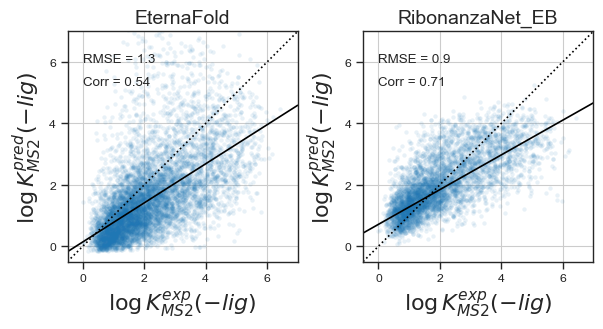
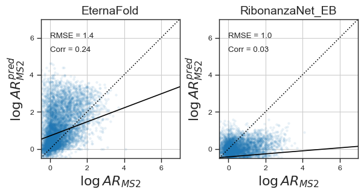

One of the most sought-after capabilities for *de novo* design of riboswitches is accurately predicting how riboswitches respond to their ligands. Before the rise of transformer-based models for macromolecule structure prediction, EternaBench was created as a diverse riboswitch benchmark dataset for training and evaluation of physics-based and probabilistic ML models, including EternaFold. The designed riboswitches in this experimental dataset each included two aptamers: the first an aptamer for an input ligand and the second for an output reporter, the fluorescently tagged MS2 viral coat protein. These riboswitches were designed so that upon binding of the input ligand (flavin mononucleotide (FMN), theophylline, or tryptophan), the MS2 protein aptamer is more accessible, thereby increasing binding affinity of the fluorescent protein. Measurements were performed on this diverse dataset for MS2 protein binding affinities with and without ligand present (K+lig and K-lig).  

[Previously](/portfolio/project-4/), I indirectly evaluated the potential for selected probabilistic, thermodynamic, and deep learning models at predicting ligand-binding affinity through a zero-shot approach by extracting the probability of the terminal base pair in the hairpin of the MS2 protein aptamer. 

Here, I wanted to fine-tune RibonanzaNet to predict these binding affinities directly, and then evaluate predictions against models that use a constrained partition function calculation to predict them. Each riboswitch contains one of three ligand-binding aptamers, and riboswitches that share an aptamer should, in theory, have the same affinity for that ligand. The prediction task is therefore not the ligand's affinity itself, but the binding affinity of the MS2 protein aptamer to the MS2 protein, both with and without ligand present. Here is a table of the binding affinities for each ligand: 

| Ligand       | Aptamer sequence         | Aptamer constraint            | Concentration  | Kd (μM)|
|--------------|--------------------------|-------------------------------|----------------|-------------------|
| FMN          | nAGGAUAU&AGAAGGn         | (xxxxxx(&)xxxxx)              | 200 μM         | 2.2               |
| Tryptophan   | AGGACCGG&CCGCCACU        | ((xxx(((&)))xxx))             | 2.4 mM         | 1.3               |
| Theophylline | GAUACCAG&CCCUUGGCAGC     | (xxx((((&)xxx)))xxx)          | 2.0 mM         | 20                |

This table is adapted from Supplementary Table 14 from the [paper](https://www.nature.com/articles/s41592-022-01605-0#Sec36) **RNA secondary structure packages evaluated and improved by high-throughput experiments**. 

My first attempt at fine-tuning involved manipulating how the model processed the *sequence features*. The simplest example included just passing the mean of the sequence features into a linear layer with an output of 2 (for the log of the riboswitch Kd with and without ligand bound). However, my attempts at processing the sequence features did not work, and predictions on the test set were essentially the same for each sequence. This makes sense because averaging the sequence embeddings effectively collapses all positional and relational information. Since the global RNA structure is the key component to predicting ligand binding and recognition, during fine-tuning the model was unable to learn anything meaningful. 

My second attempt at fine-tuning involved manipulating the *pairwise features*. My initial simple manipulation techniques did not work (including just averaging the flattened pairwise features before passing through a linear layer). This makes sense for the same reason averaging the sequence embeddings directly did not work. However, when I averaged each structural channel of the pairwise features, and then averaged the pooled channels before passing them through a linear layer, the model was able to pick up on the relationship between MS2 binding and RNA secondary/tertiary structure. 

I fine-tuned RibonanzaNet on this data (I called the fine-tuned model "RibonanzaNet-EB") in Jupyter notebooks running on GPU nodes of an HPC cluster (Slurm). You can see the training notebooks [here](https://github.com/georgiagracetully/RNET-EB). You can download the training data from the archived [EternaBench repository](https://github.com/eternagame/EternaBench/) and the base model from [RibonanzaNet](https://github.com/Shujun-He/RibonanzaNet). You can also use another RNA foundation model. 

For the data split, I trained on EternaFold's riboswitch training set, used EternaFold's holdout set as a validation set for choosing checkpoints, and tested on the remaining 5,341 riboswitches in the dataset that are in neither of those sets. Here are the results: 

Predicting MS2 binding affinity without ligand (K-lig), compared with EternaFold: 

  

RibonanzaNet-EB correlates better with experiment than EternaFold (r = 0.71 vs 0.54). Note that RMSE favors the fine-tuned model by construction, since it was trained directly on this target while EternaFold's predictions are not calibrated to this scale, so correlation is the fairer comparison.

Because many if not most riboswitches in the EternaBench dataset did not have significant differences in MS2 binding affinity with and without ligand bound, to test whether the model can predict the effect of ligand binding I also fine-tuned RibonanzaNet on the activation ratio (AR), and evaluated results: 

  

  
Here RibonanzaNet-EB fails (r = 0.03): it predicts nearly the same activation ratio for every riboswitch, which is why its RMSE looks lower than EternaFold's despite having essentially no correlation. In other words, this fine-tuned model can predict MS2 binding in the absence of ligand, but not the shift in structural ensemble caused by ligand binding. Combined with a model pretrained on reactivity data with ligand bound (see [here](/portfolio/project-5/)), I am hopeful that this would be possible. 
